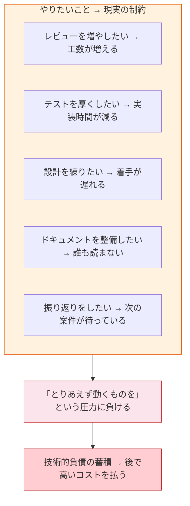
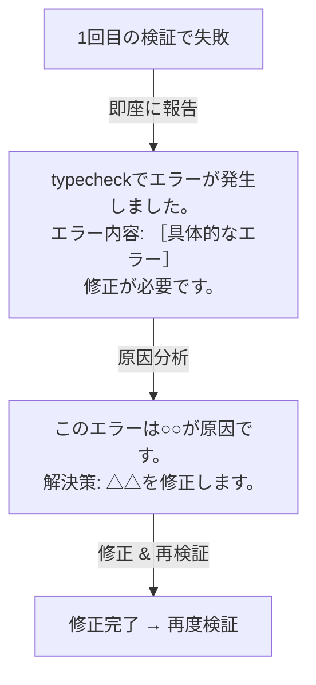
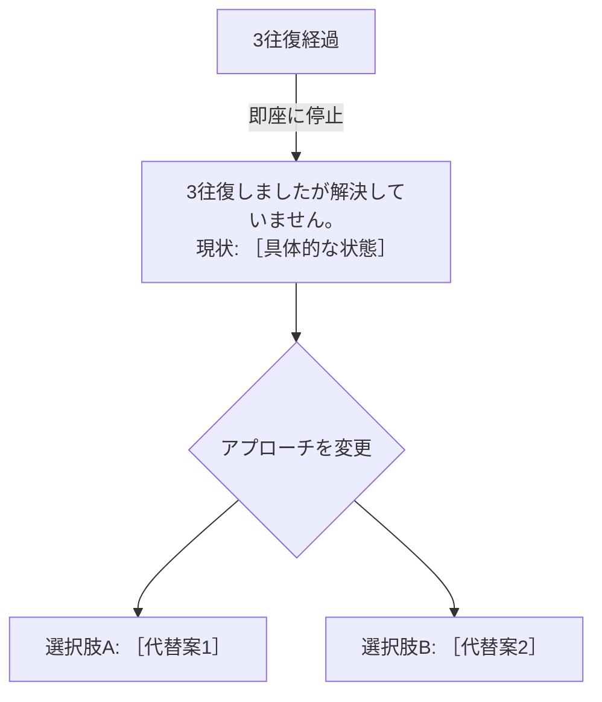
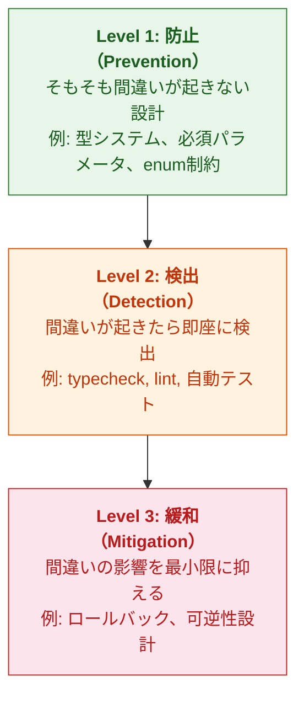
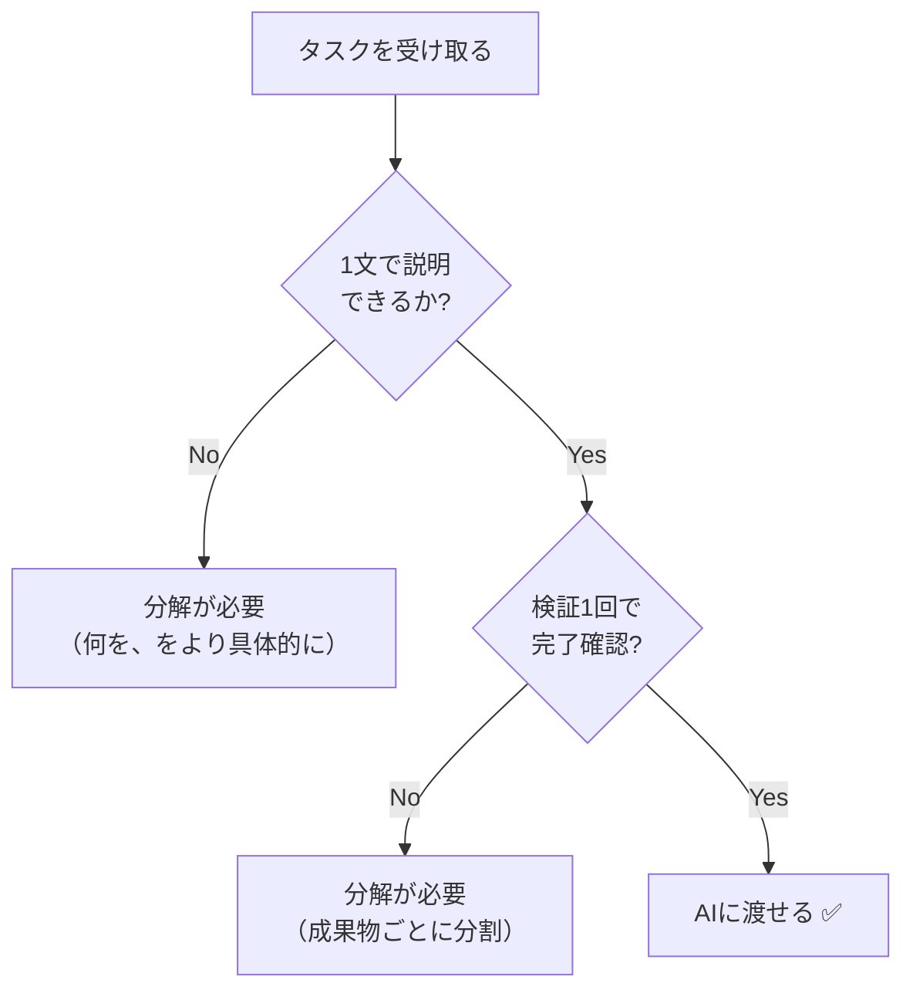

# Part 0: Level 2-3【態度・手段】急がば回れ・シンプルさ

> **このファイルの位置づけ**: [Part 0: 哲学と原則](./00-philosophy.md)の詳細ドキュメント
>
> **対象レベル**: L1(基礎)
>
> **内容**: Level 2「急がば回れ」、Level 3「シンプルさ」、「1文1検証」原則

---

## Level 2【態度】急がば回れ — 丁寧に、しかし着実に [L1]

> **階層での位置**: 態度層(L2) → 環境があるから可能になる姿勢
>
> **問いかけ**: 丁寧さを保てているか?検証を省略していないか?
>
> **関係**: 急がば回れを実践するために、シンプルさ(手段)が必要

### この層が防いでいる負の増幅:エラーの連鎖的蓄積

増強のメカニズムは双方向に作用します（[増強の双方向性](./00b-augmentation.md)参照）。

L2が防いでいるのは**「エラーの連鎖的蓄積」**という負の増幅です。

```
検証を省略する → 小さなエラーが残る → AIが次のステップでそのエラーを前提にする
                                          → エラーが雪だるま式に増幅される
```

AIは人間と異なり、「何かおかしい」という直感を持ちません。
前のステップに小さなエラーがあっても、AIはそれを前提として忠実に次の出力を生成します。
検証を省略するたびに、**増幅される前にエラーを止める機会を一つ失います。**

**「1文1検証」は、増幅される前にエラーを止める最小単位の防御です。**
「丁寧にやりましょう」という精神論ではなく、
増強のメカニズムが裏返るのを各ステップで食い止める構造的な仕組みです。

### エンジニアにとっての「急がば回れ」

正直に言います。

「急がば回れ」という言葉を聞いて、多くのエンジニアはこう思うでしょう。

- 「非効率の言い訳では?」
- 「締め切りがあるのに悠長なことを」
- 「理想論であって現実的ではない」

その反応は正しい。**従来の開発においては**。

従来の開発では、「丁寧にやる」ことにはコストがかかりました。



### AI時代に「急がば回れ」が現実的な戦略になった理由

AI協働開発は、この構造を根本から変えました。

**「丁寧にやる」コストが劇的に下がったのです。**

| やりたいこと | 従来のコスト | AI協働でのコスト |
|-------------|-------------|-----------------|
| レビューを増やす | 人の時間を奪う | Claudeが即座にレビュー |
| テストを厚くする | 実装時間を圧迫 | Claudeがテスト生成 |
| 設計を練る | 一人で悩む時間 | Claudeと壁打ち |
| ドキュメント整備 | 書く時間がない | Claudeが下書き生成 |
| 振り返り・言語化 | 後回しにされる | 作業の流れの中で実施 |

**AIがあるからこそ、丁寧にやれる。**
**丁寧にやるからこそ、結果的に速い。**

これが「急がば回れ」の現代的な意味です。

### 「急がば回れ」の実践

```
┌─────────────────────────────────────────────────────────────────┐
│                    「急がば回れ」の実践                          │
├─────────────────────────────────────────────────────────────────┤
│                                                                 │
│  タスク分解に時間をかける                                       │
│  ─────────────────────────                                      │
│  大きなタスクをそのまま渡すと、手戻りが発生する。               │
│  分解に10分かけることで、2時間の手戻りを防ぐ。                  │
│                                                                 │
│  検証を毎回挟む                                                 │
│  ────────────                                                   │
│  「まとめて後で確認」は、エラーの蓄積を招く。                   │
│  小さな単位で検証することで、問題を早期に発見する。             │
│                                                                 │
│  失敗をCLAUDE.mdに記録する                                      │
│  ────────────────────────                                       │
│  同じ失敗を繰り返すのは、最大の時間の無駄。                     │
│  5分の記録が、将来の数時間を節約する。                          │
│                                                                 │
│  損切りラインを設ける                                           │
│  ───────────────────                                            │
│  3往復しても解決しないなら、アプローチを変える。                │
│  固執することは「急ぐ」ことではない。                           │
│                                                                 │
└─────────────────────────────────────────────────────────────────┘
```

### フェイルファスト原則 — 失敗は早く、小さく [L2]

「急がば回れ」の実装手段として、**フェイルファスト（Fail Fast）原則**があります。

#### フェイルファストとは

> **定義**: 問題が発生したら、できるだけ早く、明確に失敗させる設計原則

従来のソフトウェア工学では、エラーハンドリングの文脈で語られてきましたが、
AI協働開発では**検証プロセス全体**に適用します。

```
┌─────────────────────────────────────────────────────────────────┐
│                フェイルファスト vs フェイルセーフ               │
├─────────────────────────────────────────────────────────────────┤
│                                                                 │
│  フェイルセーフ（従来型）                                       │
│  ─────────────────────                                          │
│  ・問題を隠して動作を継続                                       │
│  ・エラーを握りつぶす                                           │
│  ・「とりあえず動く」を優先                                     │
│  → 問題が蓄積し、後で大きな障害に                              │
│                                                                 │
│  フェイルファスト（推奨）                                       │
│  ─────────────────────                                          │
│  ・問題を即座に表面化                                           │
│  ・エラーを明確に報告                                           │
│  ・「正しく動く」を優先                                         │
│  → 問題が小さいうちに対処できる                                │
│                                                                 │
└─────────────────────────────────────────────────────────────────┘
```

#### AI協働開発でのフェイルファスト

| 場面 | フェイルファストの実践 |
|------|----------------------|
| **タスク分解時** | 曖昧さがあれば即座に分解し直す（「1文1検証」不合格で停止） |
| **プロンプト作成時** | 検証方法が不明確なら、明確になるまで進めない |
| **AI出力確認時** | 最初の検証で失敗したら、即座にフィードバック |
| **損切り判断時** | 3往復で解決しないなら、即座にアプローチ変更 |

#### フェイルファストと「急がば回れ」の関係

```
┌─────────────────────────────────────────────────────────────────┐
│            フェイルファストが「急がば回れ」を実現する           │
├─────────────────────────────────────────────────────────────────┤
│                                                                 │
│  「急がば回れ」の精神:                                          │
│      丁寧に、しかし着実に。問題を先送りにしない。               │
│                                                                 │
│  フェイルファストの実践:                                        │
│      問題を早期に検出し、小さいうちに対処する。                 │
│                                                                 │
│  両者の関係:                                                    │
│      フェイルファストは「急がば回れ」を実装する                 │
│      具体的な設計原則である。                                   │
│                                                                 │
│  対応する原則:                                                  │
│      H2「早期発見・早期対処」の理論的基盤                       │
│                                                                 │
└─────────────────────────────────────────────────────────────────┘
```

#### フェイルファストの実装パターン

**1. 入力検証でのフェイルファスト**

```typescript
// ❌ フェイルセーフ（問題を隠す）
function processTask(task: string | undefined) {
  const safeTask = task || "default";  // 問題を隠蔽
  // ... 処理続行
}

// ✅ フェイルファスト（問題を表面化）
function processTask(task: string) {
  if (!task || task.trim() === "") {
    throw new Error("タスクが空です。1文で説明できるタスクを指定してください。");
  }
  // ... 処理続行
}
```

**2. 検証ループでのフェイルファスト**



**3. 損切りでのフェイルファスト**



> **補足**: フェイルファストは「すぐに諦める」ことではありません。
> 「問題を早く見つけて、正しい方向に素早く修正する」ことです。
> これは心理的安全性（L1）があるからこそ可能になります。

### ポカヨケ — 失敗を防ぐ仕組み [L2]

フェイルファストが「失敗を早く検出する」原則なら、
**ポカヨケ（Poka-Yoke）**は「そもそも失敗を防ぐ」仕組みです。

#### ポカヨケとは

> **定義**: 人間の不注意や間違いを、仕組みで防止する設計手法
> （トヨタ生産方式由来、新郷重夫が体系化）



#### AI協働開発でのポカヨケ実践

| レベル | AI協働での実践 | 具体例 |
|--------|---------------|--------|
| **防止** | 型設計で曖昧さを排除 | `TaskStatus = "pending" \| "done"` |
| **防止** | CLAUDE.mdで禁止事項を明示 | `# 絶対にやらないこと` |
| **検出** | 検証コマンドの標準化 | `npm run typecheck && npm run lint` |
| **検出** | 「1文1検証」で即時確認 | 出力ごとに検証を挟む |
| **緩和** | 可逆性設計（R1-R3） | いつでもAIなしに戻れる |
| **緩和** | Git worktree分離 | 失敗しても本流に影響なし |

#### ポカヨケとフェイルファストの関係

```
┌─────────────────────────────────────────────────────────────────┐
│              ポカヨケ + フェイルファスト = 多層防御              │
├─────────────────────────────────────────────────────────────────┤
│                                                                 │
│  第1層: ポカヨケ（防止）                                        │
│        → 型システム、CLAUDE.mdの制約                            │
│        → そもそも間違いを起こさせない                          │
│                                                                 │
│  第2層: ポカヨケ（検出）+ フェイルファスト                      │
│        → typecheck, lint, test                                  │
│        → 間違いを即座に検出し、即座に報告                      │
│                                                                 │
│  第3層: ポカヨケ（緩和）                                        │
│        → 可逆性設計、損切りルール                              │
│        → 間違いの影響を最小限に                                │
│                                                                 │
│  この多層防御が「急がば回れ」を支える                           │
│                                                                 │
└─────────────────────────────────────────────────────────────────┘
```

> **H2「早期発見・早期対処」との関係**:
> ポカヨケの「検出」レベルが、H2の具体的実装手段となります。

### 契約による設計（Design by Contract）— 約束を明文化する [L2]

フェイルファストとポカヨケを補完する概念として、**契約による設計（DbC）**があります。

#### 契約による設計とは

> **定義**: ソフトウェアコンポーネント間の「契約」（事前条件・事後条件・不変条件）を
> 明示的に定義し、検証する設計手法（Bertrand Meyer, 1986）

```
┌─────────────────────────────────────────────────────────────────┐
│                    契約の3要素                                  │
├─────────────────────────────────────────────────────────────────┤
│                                                                 │
│  事前条件（Precondition）                                       │
│  ─────────────────────────                                      │
│  「この関数を呼ぶ前に、呼び出し側が保証すべきこと」             │
│  例: 引数が null でないこと、値が正の整数であること             │
│                                                                 │
│  事後条件（Postcondition）                                      │
│  ─────────────────────────                                      │
│  「この関数が完了した後に、関数側が保証すること」               │
│  例: 戻り値が有効なオブジェクトであること、状態が更新されること │
│                                                                 │
│  不変条件（Invariant）                                          │
│  ─────────────────────                                          │
│  「常に成り立つべき条件」                                       │
│  例: 残高は0以上、リストの要素数は負にならない                 │
│                                                                 │
└─────────────────────────────────────────────────────────────────┘
```

#### AI協働開発での契約

| 契約の要素 | AI協働での実践 | 具体例 |
|-----------|---------------|--------|
| **事前条件** | プロンプトでの前提明示 | 「入力は非空の文字列配列です」 |
| **事後条件** | 検証基準の明確化 | 「typecheckが通ること」 |
| **不変条件** | CLAUDE.mdでのルール | 「既存テストは壊さない」 |

#### 「1文1検証」との関係

「1文1検証」原則は、DbCをタスク設計に適用したものです:

| DbC | 「1文1検証」 |
|-----|-------------|
| 事前条件 | 「1文で説明できる」= 入力の明確化 |
| 事後条件 | 「検証1回で確認できる」= 出力の明確化 |
| 不変条件 | CLAUDE.mdのルール = 常に守るべき制約 |

#### TypeScriptでの契約の表現

```typescript
// 事前条件: 型で表現（NonZeroNumberは0以外を保証）
function divide(a: number, b: NonZeroNumber): number {
  return a / b;  // b が 0 でないことは型で保証
}

// 事後条件: Result型で表現
function findUser(id: UserId): Result<User, NotFoundError> {
  // 成功時はUser、失敗時はNotFoundErrorを返すことを型で保証
}

// 不変条件: Branded Typeで表現
type PositiveNumber = number & { readonly brand: unique symbol };
function validatePositive(n: number): PositiveNumber | null {
  return n > 0 ? n as PositiveNumber : null;
}
```

> **H1「設計 → 実装 → 検証」との関係**:
> DbCは「設計」段階で契約を定義し、「実装」で契約を満たし、
> 「検証」で契約が守られたかを確認するフローを構造化します。

### 「急がば回れ」の具体的成果: 並列作業の実現

原則を守ることで得られる重要な成果があります。
**チームでも個人でも、並列作業が可能になる**ことです。

```
┌─────────────────────────────────────────────────────────────────┐
│              原則 → 並列化 → 効率向上 の因果関係                 │
├─────────────────────────────────────────────────────────────────┤
│                                                                 │
│  「1文1検証」を守る                                             │
│        │                                                        │
│        ↓                                                        │
│  タスクが明確で独立している                                     │
│        │                                                        │
│        ↓                                                        │
│  複数のタスクを同時に進められる                                 │
│  (チームで分担 or 個人で複数セッション)                        │
│        │                                                        │
│        ↓                                                        │
│  開発効率が最大化される                                         │
│                                                                 │
│  ────────────────────────────────────────────────────────────── │
│                                                                 │
│  ❌ 原則を省略すると                                            │
│  タスクが曖昧 → 依存関係が不明 → 同時作業でコンフリクト       │
│  → 手戻り発生 → 結局遅くなる                                   │
│                                                                 │
└─────────────────────────────────────────────────────────────────┘
```

これは逆説的に聞こえるかもしれません。
「丁寧にやる」ことが「速くなる」理由は、**並列作業を可能にする**からです。

- 原則を守ったタスクは、誰が見ても範囲が明確
- 検証基準があるから、完了の判断にブレがない
- インターフェースが型で定義されているから、統合時のコンフリクトが最小

> 💡 並列作業の具体的な方法は [Part 1: 効率と品質のバランス](./01f-efficiency.md) を参照。

### 「急がば回れ」は弱さではない

「急がば回れ」を実践することは、弱さの表れではありません。

- 慎重であることは、臆病ではない
- 丁寧であることは、遅いことではない
- 検証することは、自信がないことではない

**むしろ、確実に前進するための強さです。**

速く見えて後退している開発より、
ゆっくり見えて確実に前進している開発の方が、
最終的には速い。

---

## Level 3【手段】シンプルさ — 複雑さは敵 [L1]

> **階層での位置**: 手段層(L3) → 上位Levelを実現するための方法
>
> **問いかけ**: 1文で説明できるか?検証1回で確認できるか?
>
> **関係**: シンプルさは、丁寧さ・安心・持続を可能にする「手段」
>
> **補足**: この「シンプルさ」は、禅の美学における「簡素（kanso）」— 不要なものを削ぎ落とし本質を残す精神 — にも通じます。ただし、本フレームワークでは「引き算の美」だけでなく、「分解して管理可能にする」という工学的な意味合いも含みます。

### この層が防いでいる負の増幅:複雑性の自己増殖

増強のメカニズムは双方向に作用します（[増強の双方向性](./00b-augmentation.md)参照）。

L3が防いでいるのは**「複雑性の自己増殖」**という負の増幅です。

```
曖昧な指示 → AIが解釈を補完して複雑な出力 → 人間が把握しきれない
    ↑                                                         ↓
    └────────── さらに曖昧な修正指示 ←────────────────────────┘
```

AIは曖昧さを受け取ると、「親切心」から解釈を補完して出力します。
その出力は往々にして入力より複雑になり、人間が全体を把握できなくなります。
把握できないまま修正指示を出すと、さらに複雑な出力が返る。
**増強のメカニズムが、複雑性を自己増殖させる装置になります。**

**シンプルさの哲学は、増幅される入力そのものを制御する設計です。**
「1文で説明でき、検証1回で確認できる」粒度にすることで、
AIに渡す入力の品質を構造的に保証し、複雑性の自己増殖を断ち切ります。

### 「難しいことを考えるのが凄い」という幻想

エンジニアの世界には、複雑さを美徳とする文化があります。

- 複雑なアーキテクチャを設計できる人が「凄い」
- 難解なコードを読める人が「優秀」
- 抽象度の高い議論ができる人が「上級者」

しかし、本当にそうでしょうか。

**複雑なものを複雑なまま扱うのは、実は簡単です。**
**複雑なものをシンプルにするのが、本当に難しい。**

### AIに与えるべきものは、究極的にシンプルな思考

AIは、人間が与えたものを増幅します。

- 複雑な指示を与えれば、複雑な(そして往々にして間違った)出力が返る
- シンプルな指示を与えれば、シンプルで正確な出力が返る

```
┌─────────────────────────────────────────────────────────────────┐
│                    入力と出力の関係                              │
├─────────────────────────────────────────────────────────────────┤
│                                                                 │
│  複雑な入力                                                     │
│  「認証機能を実装して。JWTとセッションの両方をサポートして、    │
│   ソーシャルログインも入れて、権限管理もよろしく」              │
│                                                                 │
│         ↓                                                       │
│                                                                 │
│  複雑で不確実な出力                                             │
│  ・どこから手をつけたかわからない                               │
│  ・一部は正しいが、一部は間違っている                           │
│  ・検証が困難                                                   │
│                                                                 │
├─────────────────────────────────────────────────────────────────┤
│                                                                 │
│  シンプルな入力                                                 │
│  「Userエンティティを作成してください。                         │
│   id, email, passwordHash, createdAt を持つ。                   │
│   完了したらtypecheckを実行して結果を教えてください」           │
│                                                                 │
│         ↓                                                       │
│                                                                 │
│  シンプルで確実な出力                                           │
│  ・やるべきことが明確                                           │
│  ・正しいか間違っているか判断できる                             │
│  ・検証が容易                                                   │
│                                                                 │
└─────────────────────────────────────────────────────────────────┘
```

### シンプルさの実践

| 複雑 | シンプル |
|------|---------|
| 大きな機能を一度に作る | 小さなタスクに分解する |
| 曖昧な言葉で伝える | 型で意図を明示する |
| 複数の条件を一度に指示 | 1つの明確なゴールを示す |
| 「適切に」「いい感じに」 | 具体的な完了条件を定義 |

**シンプルな入力から、何十倍もの成果が得られます。**

これは逆説ではありません。
シンプルだからこそ、正確に伝わり、正確に検証でき、正確に積み上がるのです。

### POLA（最小驚き原則）— 予測可能な設計 [L2]

「シンプルさ」を実現するための設計原則として、**POLA（Principle of Least Astonishment）**があります。

#### POLAとは

> **定義**: システムの振る舞いが、ユーザーの予測と一致するように設計する原則
> （「最小驚き原則」「驚き最小の法則」とも）

```
┌─────────────────────────────────────────────────────────────────┐
│                    POLA の核心                                  │
├─────────────────────────────────────────────────────────────────┤
│                                                                 │
│  「驚き」が発生する = 認知負荷が増加する                        │
│                                                                 │
│  予想外の動作                                                   │
│      ↓                                                          │
│  「なぜこうなった?」と考える時間                                │
│      ↓                                                          │
│  認知リソースの浪費                                             │
│      ↓                                                          │
│  ミスの増加、生産性低下                                         │
│                                                                 │
│  POLAを適用すると:                                              │
│      ↓                                                          │
│  予想通りの動作                                                 │
│      ↓                                                          │
│  認知負荷ゼロで次に進める                                       │
│      ↓                                                          │
│  スムーズな作業フロー                                           │
│                                                                 │
└─────────────────────────────────────────────────────────────────┘
```

#### AI協働開発でのPOLA

| 場面 | POLAの適用 | 驚きを減らす設計 |
|------|-----------|-----------------|
| **プロンプト設計** | 指示と出力の対応を予測可能に | 「○○してください→○○しました」 |
| **命名規則** | 名前から機能が推測できる | `validateEmail()` は検証のみ |
| **ファイル構造** | 配置から内容が推測できる | `src/entities/` にはエンティティのみ |
| **エラーメッセージ** | 原因と対処が明確 | 「○○エラー。△△を確認してください」 |

#### POLAと「1文1検証」の関係

「1文1検証」原則は、POLAをタスク設計に適用したものと言えます:

| POLA | 「1文1検証」 |
|------|-------------|
| 予測可能な入力 | 1文で説明できる = 曖昧さがない |
| 予測可能な出力 | 1検証で確認できる = 完了条件が明確 |
| 驚きの排除 | 「思っていたのと違う」が発生しない |

> **S1との関係**: POLAは「1文1検証」の設計原則としての理論的基盤です。

### 「1文1検証」原則 — シンプルさの判断基準

「シンプル」と「複雑」の境界は、主観的になりがちです。
**「1文1検証」原則**を使うことで、客観的に判断できます。

#### 核心:2つの問い

タスクを受け取ったら、この2つを問いかける:

| 問い | チェック内容 | 満たさない場合 |
|------|-------------|---------------|
| **1文で説明できるか?** | 曖昧さがない、「?して?して」がない | → 分解が必要 |
| **検証1回で確認できるか?** | typecheck/lint/test の1つで完了確認 | → 分解が必要 |

**両方を満たせば、そのタスクはAIに渡せる。**

#### なぜこの2つなのか

```
┌─────────────────────────────────────────────────────────────────┐
│         「1文1検証」がAIプロンプトの本質を捉える理由            │
├─────────────────────────────────────────────────────────────────┤
│                                                                 │
│  「1文」= 入力の品質保証                                        │
│  ─────────────────────                                          │
│  ・曖昧さがない → AIの解釈のブレを防ぐ                         │
│  ・スコープが限定 → AIが集中できる                             │
│  ・完了状態が明確 → AIが何を作ればいいか理解する               │
│                                                                 │
│  「1検証」= 出力の品質保証                                      │
│  ───────────────────────                                        │
│  ・完了基準が客観的 → AIの出力を判断できる                     │
│  ・フィードバックが即座 → 修正サイクルが速い                   │
│  ・成功/失敗が二値 → 「なんとなくOK」を排除                    │
│                                                                 │
└─────────────────────────────────────────────────────────────────┘
```

#### 「1文1検証」の認知科学的根拠 [L2]

「1文1検証」は単なる経験則ではなく、**人間の認知特性に基づく科学的原則**です。

##### 認知負荷理論（Cognitive Load Theory）

John Swellerが1980年代に提唱した理論で、学習と問題解決におけるワーキングメモリの役割を説明します。

```
┌─────────────────────────────────────────────────────────────────┐
│                  認知負荷の3種類                                │
├─────────────────────────────────────────────────────────────────┤
│                                                                 │
│  内在的負荷（Intrinsic Load）                                   │
│  ─────────────────────────────                                  │
│  タスク自体の複雑さに由来する負荷                               │
│  → 「1文1検証」で管理可能なレベルに分解                        │
│                                                                 │
│  外在的負荷（Extraneous Load）                                  │
│  ─────────────────────────────                                  │
│  不適切な提示方法による無駄な負荷                               │
│  → シンプルな入力で最小化                                       │
│                                                                 │
│  本質的負荷（Germane Load）                                     │
│  ─────────────────────────────                                  │
│  学習・スキーマ構築に必要な負荷                                 │
│  → 検証による学びに集中させる                                   │
│                                                                 │
└─────────────────────────────────────────────────────────────────┘
```

##### ワーキングメモリの制約

George Millerの「マジックナンバー7±2」（1956年）、Nelson Cowanの「4±1」（2001年）により、人間が一度に処理できる情報チャンクの上限が明らかになっています。

**現代の研究では4±1項目が妥当とされています。**

| 制約 | 「1文1検証」への適用 |
|------|---------------------|
| 4±1項目 | 1タスク = 1チャンク（処理単位） |
| チャンキング | タスク分解 = 適切なチャンク化 |
| 容量限界 | 複数タスクの同時処理を避ける |

##### なぜ「1文」なのか — 認知的な意味

「1文で説明できる」という基準は、以下を保証します:

1. **単一のチャンク**: 1つの処理単位として認識可能
2. **曖昧さの排除**: 複数解釈の余地がない
3. **即座の理解**: ワーキングメモリに収まる

##### なぜ「1検証」なのか — 認知的な意味

「検証1回で確認できる」という基準は、以下を保証します:

1. **即時フィードバック**: 結果がすぐにわかる
2. **二値判断**: 成功/失敗が明確（曖昧さがない）
3. **学習促進**: 成功体験の蓄積、失敗からの学び

**つまり「1文1検証」は、人間の認知限界に適合した作業単位を定義する原則です。**


#### 「1文1検証」のソフトウェア工学的根拠 [L2]

「1文1検証」は認知科学だけでなく、**OSSが30年かけて実証した協働原理**とも同じ構造を持っています。

##### OSSのPull Requestモデルとの同型性

OSSコミュニティが非同期・分散環境でソフトウェア品質を維持できた核心原理は、**変更の粒度を小さく保つこと**でした。この原理は「1文1検証」と構造的に同一です。

```
┌─────────────────────────────────────────────────────────────────┐
│        OSSのPull Requestモデル と 「1文1検証」の同型性          │
├─────────────────────────────────────────────────────────────────┤
│                                                                 │
│  OSS (Pull Request)              AI協働 (1文1検証)             │
│  ──────────────────              ────────────────────           │
│                                                                 │
│  コミットを小さくする    ←→    タスクを小さくする              │
│                                                                 │
│  PR説明文で                      1文で説明できる               │
│  「なぜ」を言語化        ←→    レベルまで分解                  │
│                                                                 │
│  小さいPRは                      1回の検証で                    │
│  レビューしやすい        ←→    完了確認できる                  │
│                                                                 │
│  CIが通らないPRは                検証基準を満たさない           │
│  マージ不可              ←→    出力は不採用                    │
│                                                                 │
├─────────────────────────────────────────────────────────────────┤
│                                                                 │
│  共通原理:                                                      │
│  ━━━━━━━━                                                      │
│  「粒度の制御が協働の品質を決める」                             │
│                                                                 │
└─────────────────────────────────────────────────────────────────┘
```

| 観点 | OSS (Pull Request) | AI協働 (1文1検証) |
|------|---|---|
| 核心原理 | 変更の粒度を小さくする | タスクの粒度を小さくする |
| 意図伝達 | PR説明文で「なぜ」を言語化 | 1文で説明できるレベルまで分解 |
| 検証 | 小さいPRはレビューしやすい | 1回の検証で完了確認できる |
| 品質保証 | CIが通らないPRはマージ不可 | 検証基準を満たさない出力は不採用 |
| 失敗時の影響 | 小さいPRなら巻き戻しが容易 | 小さいタスクなら修正が容易 |

##### なぜ同じ原理が有効なのか

コミットが大きすぎるとレビューできません。タスクが大きすぎると検証できません。PR説明文が曖昧だとレビュアーが意図を読めません。指示が曖昧だとAIが意図を読めません。

これは偶然の一致ではなく、**協働における根本的な制約**——相手（人間であれAIであれ）に意図を正確に伝え、その結果を確実に検証するには、粒度を制御するしかない——から生じる必然的な構造です。

##### 3つの理論的裏付けの統合

「1文1検証」は、3つの異なる学問領域から裏付けられています。

```
┌─────────────────────────────────────────────────────────────────┐
│          「1文1検証」の3つの理論的裏付け                         │
├─────────────────────────────────────────────────────────────────┤
│                                                                 │
│  認知科学              ソフトウェア工学       科学哲学          │
│  ━━━━━━━━              ━━━━━━━━━━━━━━━      ━━━━━━━━         │
│  認知負荷理論          OSSのPull Request       反証主義         │
│  （Sweller）           モデル                 （Popper）        │
│  ワーキングメモリ      「小さなコミット」                       │
│  制約（Cowan）         の原則                                   │
│                                                                 │
│        ↓                    ↓                     ↓             │
│  人間の認知限界に    協働の品質を            検証基準を先に     │
│  適合               実証的に維持            定義することで     │
│                                             反証可能性を確保   │
│                                                                 │
│        └──────────── 「1文1検証」 ────────────┘                │
│                                                                 │
│            理論・実践・認識論の三面から裏付け                    │
│                                                                 │
└─────────────────────────────────────────────────────────────────┘
```

- **認知科学の視点** [E]: 人間のワーキングメモリは4±1チャンクしか保持できない。1文1検証はこの制約に適合した作業単位
- **ソフトウェア工学の視点** [H]: 30年のOSS開発で「小さなPR」が品質維持の核心とされてきた。1文1検証は同じ原理のAI協働版
- **科学哲学の視点** [H]: 検証基準を先に定義する行為は、反証可能性の確保そのもの。何をもって「失敗」とするかが明確でなければ、品質は保証できない（詳細は後述）

> **参考**: 
> - Eric S. Raymond, "The Cathedral and the Bazaar," 1997（OSSの協働モデル）
> - GitHub, "Best practices for pull requests"（PRの粒度に関するガイドライン）

> 📚 根拠の表記 [E][F][A][H] と、1文1検証を支えるその他の学術的知見は [学術基盤](./00j-academic-foundations.md#1文1検証) を参照。

##### 3つ目の理論的レンズ: 反証的思考（Falsification） [L2]

「1文1検証」には、認知科学とソフトウェア工学に加えて、もう一つの理論的レンズがあります。それは**反証**——「正しいことを確認する」のではなく、「間違いを積極的に探す」という認識論的姿勢です。

###### Dijkstraの洞察: 検証の限界

1969年、Edsger Dijkstraは次のように述べました。

> **「テストはバグの存在を示せるが、不在は示せない」**

この命題は、科学哲学者カール・ポパーの反証主義と構造的に同じです。「すべての白鳥は白い」を何千羽の白い白鳥で確認しても証明にはならないが、黒い白鳥一羽で反証できる。同様に、「このプログラムはすべての入力に対して正しい」は有限のテストでは証明不可能だが、単一の失敗テストケースで反証できます。

Dave Farleyは *Modern Software Engineering*（2021年）でこの接続を明示し、「テストは反証メカニズムである」と述べています。

この洞察が重要なのは、**検証だけでは品質は保証できない**ということです。

###### 検証と反証の認識論的違い

検証と反証は、同じ成果物に対して**異なる方向の問い**を発します。

```
┌─────────────────────────────────────────────────────────────────┐
│               検証（Verification）と 反証（Falsification）       │
├─────────────────────────────────────────────────────────────────┤
│                                                                 │
│  検証の問い:   「基準を満たしているか?」                        │
│  反証の問い:   「どうすれば壊れるか?」                          │
│                                                                 │
│  ─────────────────────────────────────────────────────────────  │
│                                                                 │
│              検証                      反証                     │
│  ─────────────────────    ─────────────────────────             │
│  方向:  既知の基準に照合    未知の弱点を能動的に探索            │
│  姿勢:  答え合わせ          弱点探し                            │
│  問い:  正しく動くか?       何が壊すか?                        │
│  発見:  既知の期待への適合   未知の欠陥・前提の不備             │
│  限界:  想定済みの基準のみ   想定外の問題を発見できる           │
│  バイアス: 確証バイアスの    確証バイアスに対抗する             │
│          影響を受けやすい                                       │
│                                                                 │
└─────────────────────────────────────────────────────────────────┘
```

**同じ関数に対する2つの問い:**

```typescript
// 対象となる関数
function getUserById(id: string): User { /* ... */ }
```

```
検証の問い:
  「有効なIDを渡すと、正しいUserが返るか?」
  → テスト実行 → Pass → 完了 ✅

反証の問い:
  「この関数を壊す入力は何か?」
  → 空文字は? → SQLインジェクション文字列は?
  → 存在しないIDは? → 極端に長い文字列は?
  → nullやundefinedが渡されたら?
  → 未考慮のケースが発見される可能性 🔍
```

検証は「正しく動く」ことを確認しますが、確証バイアスの影響を受けやすい——つまり、うまくいくケースを優先的に確認してしまう傾向があります。反証は逆に、「壊れるケース」を積極的に探すことで、確証バイアスに対抗します。

###### C4（フィードバック循環）と反証的思考の違い

ここで重要な区別があります。フレームワークのC4（フィードバック循環）は**検証→修正のサイクル**を回す原則です。反証的思考はC4と矛盾するものではなく、C4の**問いの方向を拡張する**ものです。

```
┌─────────────────────────────────────────────────────────────────┐
│           C4（検証フィードバック）と 反証的思考の違い             │
├─────────────────────────────────────────────────────────────────┤
│                                                                 │
│  C4: 検証フィードバック                                         │
│  ──────────────────────                                         │
│  問い: 「この出力は指示通りか?」                                │
│  起点: 既知の検証基準（typecheck, lint, テスト）                │
│  動き: 基準に照合 → 合格/不合格 → 修正サイクル                 │
│  例:   「typecheckが通った → OK」                               │
│        「テスト3件がFailした → 修正依頼」                       │
│                                                                 │
│  反証的思考                                                     │
│  ──────────────                                                 │
│  問い: 「この設計/実装はどうすれば壊れるか?」                   │
│  起点: 想定外の状況を能動的に探索                               │
│  動き: 弱点を探す → 発見/未発見 → 設計改善                     │
│  例:   「この関数にnullを渡したら?」                            │
│        「同時に2つのリクエストが来たら?」                       │
│        「この設計はスケールするか?」                            │
│                                                                 │
│  ─────────────────────────────────────────────────────────────  │
│                                                                 │
│  関係: C4は「基準への適合」を確認するプロセス。                 │
│        反証的思考は「基準自体の十分性」を問うプロセス。         │
│        両者は補完関係にある。                                   │
│                                                                 │
└─────────────────────────────────────────────────────────────────┘
```

つまりC4が「テストに通ったか?」を問うなら、反証的思考は「そのテスト自体が十分か?」を問います。

###### フレームワーク内の反証マップ

このフレームワークには、既に反証的思考が複数の箇所に組み込まれています。ただし、明示的に「反証」とは呼ばれていません。以下のマップは、既存要素が反証のどの機能を担っているかを示します。

```
┌─────────────────────────────────────────────────────────────────┐
│               フレームワーク内の反証マップ                       │
├─────────────────────────────────────────────────────────────────┤
│                                                                 │
│  既存要素            反証としての機能         反証の種別         │
│  ━━━━━━━━            ━━━━━━━━━━━━━━         ━━━━━━━━━━        │
│                                                                 │
│  「1文1検証」        反証基準の先行定義       基準定義           │
│  (S1)               → 検証基準を先に決める                      │
│                       ことで「何が失敗か」                      │
│                       を明確にする                              │
│                                                                 │
│  フェイルファスト    反証の早期検出            検出              │
│  (H2)               → 問題を即座に表面化                       │
│                       させることで、暗黙の                      │
│                       仮定の誤りを露呈させる                    │
│                                                                 │
│  ポカヨケ            既知の反証パターンの防止  防止              │
│                     → 過去に発見された反証                      │
│                       ケースを仕組みで防ぐ                      │
│                                                                 │
│  F3: 網羅性チェック  反証ケースの探索          探索              │
│                     → エッジケースの列挙は                      │
│                       潜在的な反証ケースの                      │
│                       系統的な洗い出し                          │
│                                                                 │
│  損切りルール        反証不能からの撤退        撤退              │
│                     → 3往復で解決しないのは                     │
│                       アプローチの仮説が                        │
│                       反証された状態                            │
│                                                                 │
│  CLAUDE.md記録       反証結果の蓄積            学習              │
│                     → 発見された失敗パターン                    │
│                       を恒久的ルール化する                      │
│                       ことで反証知識を蓄積                      │
│                                                                 │
│  DbC（契約）         実行可能な反証基準        基準定義          │
│                     → 事前条件違反は即座                        │
│                       かつ正確な反証として                      │
│                       機能する                                  │
│                                                                 │
└─────────────────────────────────────────────────────────────────┘
```

これらは個別に見ると「テスト」「エラー処理」「品質保証」ですが、反証の視点で見ると**一貫した認識論的姿勢**——確認よりも反駁を優先する——で統一されていることがわかります。

###### AIによる反証の拡張: コストの壁を越える

反証的思考は従来の開発でも価値がありました。しかし「壊れるケースを網羅的に考える」ことは人間にとって認知負荷が高く、確証バイアスに抗いながら自分の設計の弱点を探すのは心理的にも難しい作業でした。

AI協働開発は、この**反証のコスト障壁を劇的に下げます**。

```
┌─────────────────────────────────────────────────────────────────┐
│           AIによる反証の拡張: 具体的なプロンプト例               │
├─────────────────────────────────────────────────────────────────┤
│                                                                 │
│  設計レベルの反証:                                              │
│  ────────────────                                               │
│  「この設計で問題が起きるシナリオを5つ挙げてください」          │
│  「この API設計の前提条件のうち、崩れる可能性があるものは?」    │
│  「この設計が破綻するのは、どのような規模・状況のときですか?」  │
│                                                                 │
│  実装レベルの反証:                                              │
│  ────────────────                                               │
│  「この関数を壊す入力パターンを網羅的に列挙してください」       │
│  「このエラーハンドリングで捕捉できない例外はありますか?」      │
│  「この並行処理でデッドロックやレースコンディションは起きますか?」│
│                                                                 │
│  仮定レベルの反証:                                              │
│  ────────────────                                               │
│  「この実装が暗黙に前提としていることを列挙してください」       │
│  「その前提のうち、将来崩れる可能性が高いものはどれですか?」    │
│                                                                 │
└─────────────────────────────────────────────────────────────────┘
```

ここで重要なのは、反証の「実行」はAIに任せられますが、**反証を求める判断は人間が行う**という点です。これはフレームワークの責任分担の原則——人間がインプットの質に責任を持ち、AIがアウトプットの質に責任を持つ——と一致しています。

> **F3（網羅性チェック）との関係**:
> F3は「漏れ・抜けがないか」を事後的に確認する検証寄りのプロセスです。
> 反証的思考はそれを拡張し、「意図的に壊しにいく」能動的なプロセスを加えます。
> F3が「チェックリストの確認」なら、反証的思考は「チェックリスト自体の妥当性を問う」行為です。

> **参考**:
> - Edsger Dijkstra, "Notes On Structured Programming" (EWD249), 1970
> - Dave Farley, *Modern Software Engineering*, 2021（テストを反証メカニズムとして位置づけ）
> - Groce et al., "How Verified (or Tested) Is My Code? Falsification-Driven Verification and Testing," *Automated Software Engineering* 25, 2018
> - Karl Popper, *The Logic of Scientific Discovery*, 1959（反証主義の基礎文献）

#### 判断フロー



#### 補助指標(参考)

「1文1検証」を満たしているタスクは、通常以下も満たす:

| 指標 | 目安 | 注意 |
|------|------|------|
| **所要時間** | 30分以内 | 超えそうなら「1検証」を再確認 |
| **変更ファイル数** | 1-3ファイル | 超えそうなら「1文」を再確認 |
| **条件分岐** | なし | 「もし?なら」は分解のサイン |

> — これらは**結果の目安**であり、判断基準ではない。
> 判断は常に「1文で説明できるか?」「検証1回で確認できるか?」で行う。

#### 分解の例

| 複雑なタスク | 問題点 | 分解後 |
|-------------|--------|--------|
| 「認証機能を実装」 | 1文NG(複数の成果物) | User作成 → ログインAPI → JWT |
| 「バグを修正してテストも追加」 | 1検証NG(2つの検証) | バグ修正 → テスト追加 |
| 「もしAならB、そうでなければC」 | 1文NG(条件分岐) | Aの場合 → それ以外 |

> — タスク分解の具体的な手順は [Part 1: タスク分解](./01c-task-decomposition.md#タスク分解ai協働開発の最重要スキル) を参照。

#### 補助原則: YAGNI (You Aren't Gonna Need It)

「1文1検証」を実践する上で、**YAGNI原則**が強力な補助になります。

```
┌─────────────────────────────────────────────────────────────────┐
│                  YAGNI と「1文1検証」の関係                      │
├─────────────────────────────────────────────────────────────────┤
│                                                                 │
│  YAGNI: 「今必要ないものは作らない」                            │
│                                                                 │
│         ↓ タスク分解に適用すると                                │
│                                                                 │
│  1文1検証: 「今この瞬間に必要な最小単位だけを指示する」         │
│                                                                 │
│         ↓ 具体例                                                │
│                                                                 │
│  ❌ 「認証機能を実装して。将来の拡張性も考慮して」              │
│  ✓ 「Userエンティティを作成して。id, email, passwordHashを持つ」│
│                                                                 │
└─────────────────────────────────────────────────────────────────┘
```

**YAGNIに反する指示 vs YAGNIに沿った指示:**

| ❌ YAGNIに反する指示 | ✓ YAGNIに沿った指示 |
|---------------------|---------------------|
| 「拡張性を考慮して」 | 「まずこの要件だけ」 |
| 「汎用的に設計して」 | 「この1ケースで動くように」|
| 「将来のために」     | 「今必要なのは」     |
| 「念のため〇〇も」   | 「〇〇は後で追加」   |

**シンプルさの3つの側面:**

```
┌─────────────────────────────────────────────────────────────────┐
│              シンプルさの3つの側面                               │
├─────────────────────────────────────────────────────────────────┤
│                                                                 │
│  YAGNI        ─── 何を作るか（スコープの制限）                  │
│  「今必要なものだけ」                                           │
│                                                                 │
│  KISS         ─── どう作るか（複雑さの制限）                    │
│  「単純な方法で」                                               │
│                                                                 │
│  1文1検証     ─── どう伝えるか（入力の制限）                    │
│  「明確に、検証可能に」                                         │
│                                                                 │
│  → 3つは補完関係にあり、すべて「シンプルさ」に貢献             │
│                                                                 │
└─────────────────────────────────────────────────────────────────┘
```

> **注意**: YAGNIは「将来を考えるな」という意味ではありません。
> 「将来必要かもしれない」と「今必要」を区別し、**今のタスクでは今必要なものだけを扱う**という原則です。
> 将来の拡張は、それが必要になったときに別タスクとして扱います。

#### 補助原則: CQS（コマンド・クエリ分離）[L3]

「1文1検証」でタスクを分解する際、**CQS原則**を意識するとより明確な分解ができます。

##### CQSとは

> **定義**: 操作を「状態を変更するコマンド」と「情報を返すクエリ」に
> 明確に分離する原則（Bertrand Meyer, 1988）

```
┌─────────────────────────────────────────────────────────────────┐
│                    CQS原則                                      │
├─────────────────────────────────────────────────────────────────┤
│                                                                 │
│  コマンド（Command）                                            │
│  ─────────────────                                              │
│  ・状態を変更する                                               │
│  ・値を返さない（または成否のみ）                               │
│  ・副作用がある                                                 │
│  例: createUser(), deleteFile(), updateStatus()                 │
│                                                                 │
│  クエリ（Query）                                                │
│  ─────────────                                                  │
│  ・状態を変更しない                                             │
│  ・値を返す                                                     │
│  ・副作用がない                                                 │
│  例: getUser(), findFiles(), calculateTotal()                   │
│                                                                 │
└─────────────────────────────────────────────────────────────────┘
```

##### AI協働でのCQS活用

タスクをCQSで分類すると、検証方法が明確になります:

| タスク種別 | 検証方法 | 例 |
|-----------|---------|-----|
| **コマンド** | 状態変更の確認 | DB更新後にSELECTで確認 |
| **クエリ** | 返却値の確認 | 期待値との比較 |
| **混合（要分解）** | 分解後にそれぞれ検証 | 「データを取得して更新」→分解 |

**プロンプト設計への適用**:

```
❌ 混合タスク（検証が難しい）
「ユーザー情報を取得して、最終ログイン日時を更新してください」

✅ 分離タスク（検証が明確）
1. 「ユーザー情報を取得する関数を作成してください」（クエリ）
2. 「最終ログイン日時を更新する関数を作成してください」（コマンド）
```

> **S1「1文1検証」との関係**:
> CQSで分類すると、自然と「1文1検証」を満たすタスクになります。

#### TDD経験者への補足

「1文1検証」の思考法は、TDD（テスト駆動開発）のアプローチと本質を共有しています。

```
┌─────────────────────────────────────────────────────────────────┐
│             「1文1検証」と TDD の対応関係                        │
├─────────────────────────────────────────────────────────────────┤
│                                                                 │
│  「1文1検証」              TDD                                   │
│  ─────────────            ────────────                          │
│                                                                 │
│  「1文」                  テストケース名                         │
│  = 何をするか明確         = 何をテストするか明確                 │
│                                                                 │
│  「1検証」                アサーション                           │
│  = 成功/失敗が二値        = Pass/Fail が二値                     │
│                                                                 │
│  検証基準を先に決める     テストを先に書く (Red)                  │
│  ↓                        ↓                                     │
│  AIに実装させる           実装する (Green)                        │
│  ↓                        ↓                                     │
│  検証で確認               テストで確認                           │
│                                                                 │
└─────────────────────────────────────────────────────────────────┘
```

| TDDの原則 | 「1文1検証」への適用 |
|----------|----------------------|
| テストを先に書く | 検証コマンドを先に決める |
| 1テスト1アサーション | 1タスク1検証基準 |
| Red → Green → Refactor | 基準設定 → 実装 → 確認 |

> 💡 **TDDの経験は前提条件ではありません。**
> 重要なのは「何をもって完了とするか」を**先に**決めること。
> これはBoris Cherny氏の「検証フィードバックループ」の本質でもあります。
> 検証手段は、テストスイートに限らず、bashコマンド（typecheck, lint）や
> ブラウザテストなど、ドメインに応じて選択できます。

#### 1文1検証の二層構造 — レビューの深さを変える [L2]

「1文1検証」の「1検証」は、typecheck・lint・testなどの**機械による検証**です。
人間がAIの出力を1文ずつ読むことを求めているわけではありません。

では、機械の検証を通った成果を、**人間はどこまで読むべきか**。
V5.0では、この問いに答えるために、1文1検証を2つの層に分けます。

| 層 | 名前 | 内容 | 変えてよいか |
|----|------|------|-------------|
| 第1層 | **単位の基準** | タスクは1文で説明でき、機械による検証1回で完了を確かめられる大きさにする | 変えない |
| 第2層 | **レビューの深さ** | 機械の検証を通った成果を、人間がどの深さで読むか | 信頼とリスクで変える |

**第2層の運用**

| 状態 | 人間のレビュー | 次の状態へ移る条件 |
|------|--------------|------------------|
| **立ち上げ期**（新しいプロジェクト、新しいモデル、初めての種類のタスク） | すべて読む | 問題のない単位が続いたら、信頼確立期へ |
| **信頼確立期** | 抜き取りで読む。**ゼロにはしない** | 品質の劣化に気づいたら、立ち上げ期へ戻る |
| **高リスク**（本番、セキュリティ、元に戻せない操作） | 信頼に関係なく、すべて読む | 常にこの扱い |

```
┌─────────────────────────────────────────────────────────────────┐
│               レビューの深さ — 3つの約束                        │
├─────────────────────────────────────────────────────────────────┤
│                                                                 │
│  1. 機械の検証（第1層）は、どの状態でも省略しない               │
│  2. 人間のレビューは、減らしてもゼロにはしない（BL4）           │
│  3. 高リスクの変更は、信頼に関係なくすべて読む（BL2）           │
│                                                                 │
└─────────────────────────────────────────────────────────────────┘
```

**なぜ動かすのか**

- 常にすべてを読む戦略は、安全ですが、人間の注意力を使い果たします。信頼が積み上がったあとは、抜き取りの方が長期的に優れることが、進化ゲーム理論の分析で示唆されています。同じ分析は、確認を**ゼロにすると協力が崩れる**ことも示しています（Han, Perret & Powers 2021）[F]
- 信頼は、AIの実際の能力に合わせて較正されるべきものです（信頼較正理論、Lee & See 2004）[E]。立ち上げ期に読むのは、較正のための観察です

> ⚠️ 「何単位続いたら」「何割を抜き取るか」に、学術的に決まった数値はありません。
> チームで目安を決め、[CLAUDE.md](./03-practices.md#12-claudemd-の進化モデル-l1) に書いておいてください。
> 目安は**実践的な目安**であり、研究に基づく数値ではありません。

#### 反証の原則 — 「何が起きたら間違いか」を先に決める [L2]

[3つ目の理論的レンズ: 反証的思考](#3つ目の理論的レンズ-反証的思考falsification-l2) で見たように、
検証は「期待どおりに動くか？」を、反証は「どうすれば壊れるか？」を問います。
AIの出力はもっともらしく見えるため、**確かめにいくだけでは、もっともらしい間違いを見逃します**。

V5.0では、この反証的思考を、タスクを渡すたびに使う原則として明文化します。

> **反証の原則**: タスクを渡す前に、「何が起きたら、この成果は間違いか」を1つ以上決めておく。

| 書き方の例 | 反証の種類（[反証マップ](#フレームワーク内の反証マップ)） |
|-----------|------------------------------------------|
| 「空配列を渡して例外が出たら失敗」 | 基準定義 |
| 「既存のテストが1つでも落ちたら失敗」 | 検出 |
| 「認証なしでこのAPIが呼べたら失敗」 | 探索 |

> 📚 反証は、確かめる試みより反駁する試みで知識が進むという、Popperの反証主義に由来します [H]。
> 詳しくは [学術基盤](./00j-academic-foundations.md#7つの知的源流-l2) を参照。

#### Human-on-the-Loop — 自律的に動くAIとの検証の分担 [L2]

AIエージェントが数十から数百のステップを自律的に進めるとき、人間がすべてのステップに立ち会うことはできません。
それでも1文1検証は成り立ちます。**検証の主体が、もともと機械だから**です。

変わるのは、人間の関わり方です。

| 関わり方 | 人間の役割 | 向いている場面 |
|---------|----------|-------------|
| **Human-in-the-Loop** | 各単位の成果をその場で確かめる | 対話しながら進める作業、立ち上げ期 |
| **Human-on-the-Loop** | **反証の基準を設計し**、反証の実行はAIやツールに任せ、**結果を評価して判断する** | 自律的に長く動くエージェント、並列作業 |

```
┌─────────────────────────────────────────────────────────────────┐
│           Human-on-the-Loop での分担                            │
├─────────────────────────────────────────────────────────────────┤
│                                                                 │
│  人間  : 何が起きたら間違いかを決める（反証の基準）             │
│    ↓                                                            │
│  AI    : 単位ごとに実装し、機械の検証と反証を実行する           │
│          （テスト、型、レビューエージェント、境界値の攻撃）     │
│    ↓                                                            │
│  人間  : 結果を評価し、レビューの深さに従って読み、判断する     │
│          最終判断は人間（BL1）                                  │
│                                                                 │
└─────────────────────────────────────────────────────────────────┘
```

> 💡 Human-on-the-Loop は「人間が手を離すこと」ではありません。
> 人間は、**何をもって失敗とするかを決める**という、より上流の判断を担います。
> これは Licklider（1960）が描いた「人間は基準を決め、評価する」という役割分担そのものです [H]。

役割分担の全体像は [Part 1: 役割分担モデル](./01d-roles.md) を参照してください。

---

---

次のドキュメント: [00f-principles.md](./00f-principles.md)（28の原則・まとめ）
