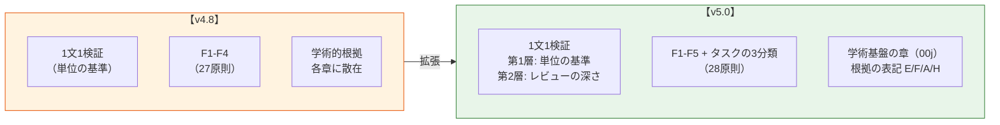

# v5.0 移行ガイド: 学術基盤の統合とエージェント時代への対応

> **対象読者**: v4.x のフレームワークを利用していた方
>
> **所要時間**: 約15分

---

## 変更の概要

v5.0は、**フレームワークを置き換える改訂ではありません**。
L0〜L4の階層、BL1〜BL4、増強の哲学はそのままに、次の2つを行いました。

1. **学術基盤の統合** — 原則の根拠を一か所にまとめ、根拠の強さ（実証か、たとえ話か）を区別して示す
2. **エージェント時代への対応** — AIが長く自律的に動く状況でも成り立つように、検証と役割分担の原則を精密にする

---

## 何が変わったか（6つ）

| # | 変更 | 一言で | 詳細 |
|---|------|-------|------|
| 1 | **学術基盤の章** | 根拠を一か所に。強さを区別する | [00j](./00j-academic-foundations.md) |
| 2 | **1文1検証の二層構造** | 単位の基準は固定。人間のレビューの深さを信頼とリスクで変える | [00e](./00e-haste-simplicity.md#1文1検証の二層構造--レビューの深さを変える-l2) |
| 3 | **反証の原則と Human-on-the-Loop** | 「何が起きたら間違いか」を先に決める。人間は基準を設計し、結果を評価する | [00e](./00e-haste-simplicity.md#反証の原則--何が起きたら間違いかを先に決める-l2)、[01d](./01d-roles.md) |
| 4 | **F5とタスクの3分類** | 判断のタスクでは人間が先に見立てを持つ。27原則 → 28原則 | [00g](./00g-ai-first.md#タスクの3分類--誰が主導するか-l2) |
| 5 | **認知的関与を保つ3つの仕組み** | 頼りすぎを「心がけ」ではなく仕組みで防ぐ | [00c](./00c-sustainability.md#認知的関与を保つ3つの仕組み-l2) |
| 6 | **構造的心理的安全性** | 声を上げることを、勇気ではなく仕組みで支える | [00d](./00d-psychological-safety.md#構造的心理的安全性--勇気に頼らない仕組み-l2) |

---

## なぜ変更したのか

学術的な知見を整理したところ、多くの研究が「1文1検証」を支持していました。
一方で、**v4.8の書き方に修正を迫る知見**も見つかりました。

| 見つかった知見 | v4.8で足りなかったこと | v5.0での変更 |
|-------------|--------------------|------------|
| 人間とAIの組み合わせは、判断のタスクでは平均して性能が下がる | F1「初期案はAIから」を判断にも当てはめていた | F1を生成に限定し、F5を追加 |
| 常に全量を確かめる戦略は、信頼に基づく戦略に長期的に劣る（ただしゼロは崩れる） | レビューの深さが一律だった | 1文1検証の第2層 |
| AIを使うと自己評価が甘くなり、AIに詳しい人ほどその傾向が強いことがある | 頼りすぎへの対策が「心がけ」だった | 3つの仕組み |
| エージェントが長く自律的に動くと、人間が各ステップを確認できない | 人間の役割が「各ステップの確認者」だけだった | Human-on-the-Loop |

詳しくは [学術基盤：反証側の知見](./00j-academic-foundations.md#反証側の知見--フレームワークに疑問を投げる研究-l2) を参照してください。

---

## 移行のチェックリスト

v4.xの運用から移るときに、チームで確認してください。

### すぐにやること

- [ ] **レビューの深さの状態を決める** — 今のプロジェクトは「立ち上げ期」か「信頼確立期」か。高リスクとして常にすべて読む領域（認証、決済など）はどこか
- [ ] **CLAUDE.md に書く** — 状態、抜き取りの目安、立ち上げ期に戻す条件（[書き方の例](./03-practices.md#反証の基準とレビューの深さv50)）
- [ ] **タスクを渡すときに反証の基準を1行添える** — 「何が起きたら失敗か」

### 次の振り返りまでにやること

- [ ] **判断のタスクで F5 を試す** — 設計方針などを決めるとき、AIに聞く前に自分の見立てを1行書く
- [ ] **予測→実測の振り返りを始める** — 任せる前に1行、終わったら1行
- [ ] **チーム規範に5項目目を加える** — 「AIの使い方を隠さない、強制しない」

### 時間があるときにやること

- [ ] **AIアンドン、AIヒヤリハット記録の導入を検討する**
- [ ] **[学術基盤の章](./00j-academic-foundations.md)を読む** — 特に「根拠の読み方」

---

## 変わらないもの

| 項目 | 状態 |
|------|------|
| L0〜L4の階層構造と「上位が優先」の判断原則 | ✅ 変更なし |
| BL1〜BL4 | ✅ 変更なし |
| 増強の哲学、増強の双方向性、無慈悲な親切心 | ✅ 変更なし（根拠を補強） |
| 「1文1検証」の名前と、第1層（単位の基準）の定義 | ✅ 変更なし |
| 既存の27原則 | ✅ 変更なし（F1は範囲を明確化、F5を追加） |

---

## よくある質問

**Q. 1文1検証は「人間が1文ずつ読む」ことだったのですか？**

いいえ。v4.xから、「1検証」は typecheck・lint・test などの**機械による検証**を指していました。
v5.0では、その上に「人間がどこまで読むか」という第2層を加えました。

**Q. 信頼確立期になったら、人間はレビューしなくてよいのですか？**

いいえ。抜き取りに減らしても、**ゼロにはしません**（BL4）。高リスクの変更は、信頼に関係なくすべて読みます（BL2）。

**Q. F5があると、遅くなりませんか？**

見立ては1行で十分です。F5が対象にするのは、正解が文脈に依存する判断のタスクだけで、生成のタスクは従来どおりF1で進めます。

**Q. [E][F][A][H] の記号は何ですか？**

根拠の種類です。[E] 実証、[F] 形式理論、[A] アナロジー、[H] 哲学・歴史。詳しくは [根拠の種類の表記](./00j-academic-foundations.md#根拠の種類の表記-l1) を参照してください。

---

← [README](./README.md) | [CHANGELOG](./CHANGELOG.md) →
